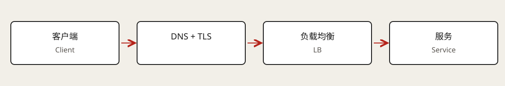

# Networking Essentials

Network design determines the path a request follows, the guarantees at each layer, and the behavior under congestion, disconnection, or regional failures. Begin with one complete request, then justify protocols, connection management, and traffic distribution.

## The complete path of an HTTPS request

Consider `GET /training-jobs/job-42`. DNS resolves the destination. If no connection can be reused, the client establishes transport and a TLS session. The HTTP request can then pass through a CDN, load balancer, application, and database before a response returns.

Separate connection setup, network round-trip time (RTT), and service processing time. Fast database work does not remove cross-continent RTT, handshake costs, or proxy queues. Connection reuse avoids repeating setup, so an HTTP request does not necessarily imply a new TCP handshake.

DNS records have caches and TTLs. Changing a record does not instantly migrate every client: failover also depends on cached addresses, existing connections, and reconnect behavior. A successful transport connection says nothing about whether a job or transaction committed.

## Responsibilities by layer

| Layer | Responsibility | What it does not guarantee |
| --- | --- | --- |
| L3: IP | Addressing, routing, and best-effort packet delivery. | Arrival or packet ordering. |
| L4: TCP and UDP; QUIC supplies modern transport capabilities | End-to-end communication with protocol-specific guarantees. | Exactly-once business execution. |
| L7: HTTP, DNS, WebSocket, and others | Requests, responses, or application message formats. | Application authorization, recovery, or consistency. |

Ports distinguish communication endpoints on a host. Service discovery and load balancing map a logical service onto reachable instances.

## TCP, UDP, and QUIC

TCP supplies an ordered, reliable byte stream with retransmission, flow control, and congestion control. It does not preserve application message boundaries: one write can require several reads. Applications need framing through lengths, delimiters, or an upper-layer protocol. Packet loss can delay later bytes while retransmission completes.

UDP sends datagrams without built-in reliable delivery, ordering, or congestion control. It fits workloads that explicitly manage loss and timeliness, such as real-time media. Late audio can be less useful than a dropped fragment. UDP is not automatically faster once an application adds its own reliability and congestion management.

QUIC runs over UDP and adds reliable streams, encryption, and connection management. HTTP/3 uses QUIC; HTTP/1.1 and HTTP/2 commonly use TCP. Independent QUIC streams reduce transport head-of-line blocking across streams, but do not eliminate congestion or all waiting.

## HTTP, TLS, and interface semantics

HTTP defines methods, status codes, headers, and bodies. HTTP/1.1 supports persistent connections, while HTTP/2 multiplexes streams. Explain which bottleneck a protocol version addresses rather than treating a version number as a performance result. [MDN's HTTP overview](https://developer.mozilla.org/en-US/docs/Web/HTTP/Guides/Overview) describes clients, servers, and intermediaries.

HTTPS protects confidentiality and integrity in transit and authenticates the server. TLS can terminate at an edge, load balancer, or application. Encrypting the separate backend hop is another deployment decision.

Encryption does not establish resource permission. An `owner_id` in a request body does not prove ownership. The server still validates identity, ownership, and allowed actions. HTTP's stateless semantics also do not imply an absence of transport connections or application sessions.

## REST, GraphQL, and gRPC

| Approach | Good fit | Cost to explain |
| --- | --- | --- |
| REST | Public resource interfaces, such as creating and reading jobs. | Complex pages may need aggregation endpoints or multiple requests. |
| GraphQL | Clients needing different fields and related data. | Resolver cost, query complexity, N+1 access, caching, and permissions. |
| gRPC | Internal services with explicit contracts or streaming calls. | Browser adaptation such as gRPC-Web and compatible infrastructure. |

gRPC commonly uses Protocol Buffers and HTTP/2 and can generate multilingual clients. Binary encoding can reduce serialization costs, but end-to-end improvements depend on the workload. REST and GraphQL are interface approaches; TCP and UDP operate at a different layer.

## Polling, SSE, and WebSocket

Polling repeatedly requests state. It is straightforward, at the cost of redundant requests and update delay up to a polling interval. It can be sufficient for infrequent updates.

Server-Sent Events (SSE) pushes text events through an HTTP response stream. It fits job progress, notifications, and generated text. Events can carry IDs; `EventSource` reconnects and can send `Last-Event-ID`. The application must still retain events, decide retention, and implement replay. Reconnection alone does not guarantee lossless recovery.

SSE deployments must handle proxy buffering, idle timeouts, and heartbeats. HTTP/1.1 browser connection limits may matter. See [MDN's SSE guide](https://developer.mozilla.org/en-US/docs/Web/API/Server-sent_events/Using_server-sent_events) for event framing.

WebSocket provides a persistent, bidirectional message channel. A common HTTP/1.1 setup uses Upgrade; other HTTP versions can establish it differently. It fits frequent interaction such as collaborative actions or chat. Applications still define message types, acknowledgments, ordering, heartbeats, and recovery: TCP reliability does not cover business replay after disconnects.

## WebRTC and NAT traversal

WebRTC commonly supports browser audio and video. Signaling exchanges session and connection-candidate information; the signaling service need not carry media. ICE gathers and checks candidates, STUN helps discover externally reachable addresses, and TURN relays when direct connectivity fails.

WebRTC therefore does not mean permanent peer-to-peer connectivity without servers. TURN incurs relay bandwidth costs. Multiparty systems often use selective forwarding units (SFUs), avoiding a separate outgoing media stream to every participant. [MDN's connectivity guide](https://developer.mozilla.org/en-US/docs/Web/API/WebRTC_API/Connectivity) explains candidate exchange and connection establishment.

## Load balancing requests and connections

Client-side balancing lets a library discover instances and select a target, but requires discovery, health tracking, and client-version management. Dedicated balancers centralize policy and forwarding, while introducing their own capacity and availability concerns.

| Choice | Routing information | Implication |
| --- | --- | --- |
| L4 | IPs, ports, and connection metadata. | Usually distributes connections without understanding HTTP paths; implementations may forward or proxy. |
| L7 | HTTP hosts, paths, headers, or cookies. | Supports content routing, TLS termination, and application policy with protocol-processing cost. |

L7 balancers can support WebSocket. Persistent connections do not automatically require L4. Consider Upgrade inspection, routing policy, product support, and capacity. Established connections usually remain attached to their backend, so adding instances may not redistribute existing traffic.

Round robin, least connections, weights, and consistent hashing suit different workloads. Equal connection counts do not imply equal CPU load. Passing health checks does not prove an instance has spare capacity. Sticky sessions can reduce state movement but complicate skew and recovery.

## Regions and failures

A CDN reduces distance for reusable content; it cannot remove all coordination from dynamic writes. Regional services require decisions about data ownership, replication, write locations, and failover.

Timeouts bound individual waits; deadlines bound the whole operation. Retries need limits, an overall budget, backoff, and jitter. Retries at several layers amplify load. Side-effecting calls need idempotency. A circuit breaker temporarily rejects calls to a failing dependency and uses limited probes to assess recovery. [AWS's retry design article](https://aws.amazon.com/builders-library/timeouts-retries-and-backoff-with-jitter/) discusses these engineering choices.

For a training platform, use idempotent HTTPS requests to create jobs, resumable SSE to display progress, and a separate WebSocket channel only where frequent bidirectional interaction requires it.

## Related notes and reading

[API design](02-api-design.md) · [Caching](05-caching.md) · [Estimation](09-capacity-estimation.md) · [Module index](../README.md)

Reviewed [Hello Interview's written Networking Essentials chapter](https://www.hellointerview.com/learn/system-design/core-concepts/networking-essentials) through the existing authenticated session. This guide uses a request-path structure, primary documentation, and original training-platform examples; it does not transcribe course videos or quizzes.
