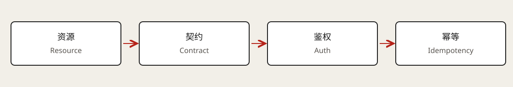

# API Design

An API contract states who may operate on which resources, how inputs are represented, what results and failures mean, and what happens when networks force retries. A training platform provides a concrete example.



## Resources and operations

Identify experiments, training jobs, and checkpoints. Put resource identity in paths, optional filters in query parameters, and creation or modification data in request bodies:

```http
POST /training-jobs
GET /training-jobs/job-42
GET /training-jobs?experiment_id=exp-7&state=running&limit=20
POST /training-jobs/job-42/cancellations
```

Cancellation can be represented as a request resource or an explicit RPC action. More important than naming is whether cancellation completes synchronously, is accepted for later execution, and tolerates repeated submission.

## Methods and status codes

| Method | Typical semantics | Retry consideration |
| --- | --- | --- |
| GET | Read a resource safely. | Results can change without creating business side effects. |
| POST | Create a resource or submit an operation. | Application deduplication is needed for idempotency. |
| PUT | Replace or create at a specified address. | Repeating the same request should have an idempotent effect. |
| PATCH | Modify part of a resource. | Setting a value differs from appending an item. |
| DELETE | Remove a resource. | Final state can be idempotent even when response codes differ. |

Return `201 Created` for completed creation and `202 Accepted` with a status location for accepted asynchronous work. `400` indicates invalid input, `401` missing valid authentication, `403` insufficient permission, `409` a state conflict, and `429` rate limiting. Stable business error identifiers supplement these categories.

## Make asynchronous operations observable

Creation can return a job ID, current state, and `Location`. Later reads expose `queued → running → succeeded/failed/cancelled`. Accepted cancellation does not prove the GPU worker has stopped.

```json
{
  "id": "job-42",
  "state": "queued",
  "attempt": 1,
  "status_url": "/training-jobs/job-42"
}
```

State and attempt number should come from controlled records. Failure reasons, retryability, and result locations belong in the contract rather than being inferred from logs.

## Bind idempotency to the business commit

Generate an idempotency key for each logical creation and reuse it across network retries. Scope records to the caller, operation, and key, and store a request digest and outcome. Incompatible key reuse should conflict.

Atomicity matters: if creation commits before its deduplication result is saved, a crash can permit duplicate creation. A transaction can store both the idempotency record and job, with a unique constraint handling concurrent requests. Define in-progress responses, retention, and behavior after expiration.

## Pagination and query cost

Offset pagination can suit stable small lists and page-number navigation. Large offsets may scan many rows, and concurrent updates can cause skips or duplicates. Cursor pagination instead records an ordering boundary:

```sql
WHERE owner_id = :owner
  AND (created_at, id) < (:last_time, :last_id)
ORDER BY created_at DESC, id DESC
LIMIT 20;
```

Use a unique ID to break timestamp ties. Bind cursors to filters and order. Cursor pagination alone does not guarantee a cross-page snapshot. Limit page sizes and supported query combinations; [design API parameters with indexes](04-database-indexing.md).

## Identity, permissions, and errors

Authentication establishes identity; authorization grants access to a resource or action. A valid JWT does not prove permission to read `job-42`. Check ownership or team permissions independently of a supplied `owner_id`.

Use consistent errors such as `{"error":{"code":"JOB_ALREADY_TERMINAL","message":"Job cannot be cancelled"}}`. Do not expose internal stacks or credentials. Rate limits may consider users, tenants, and operation costs; retry advice must respect an overall deadline.

## GraphQL, gRPC, and evolution

GraphQL suits clients selecting different shapes of overlapping data. Bound query depth and cost, batch related loads, and enforce resource permissions in resolvers. One request can still cause many database queries.

gRPC expresses typed service methods and messages, fitting internal schedulers and workers. Define deadlines, cancellation, streaming, and error mapping. Binary encoding does not remove compute or database bottlenecks.

Optional additions are often easier to evolve than changed meanings, but compatibility depends on clients. Removing fields or changing sort and error semantics can break them. Version numbers do not replace deprecation and migration rules.

## Related notes and source

[Networking](01-networking.md) · [Data modeling](03-data-modeling.md) · [Indexes](04-database-indexing.md) · [Module index](../README.md)

Learning reference: [Hello Interview · API Design](https://www.hellointerview.com/learn/system-design/core-concepts/api-design), reviewed through the authenticated written chapter. Training-job APIs, transactional deduplication, and query examples are independently organized explanations.
