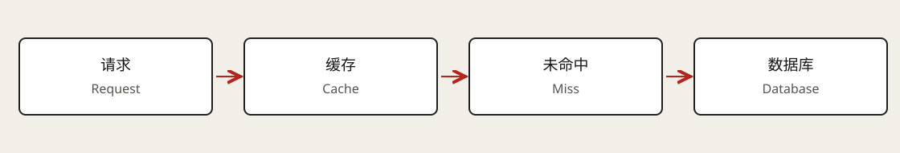

# Caching and Invalidation

Caches retain reusable data or computation results. They trade storage and consistency complexity for lower latency and less backend work. Start with a measured bottleneck and acceptable freshness, rather than adding Redis by habit.

## Placement changes the cost

| Location | Benefit | Cost |
| --- | --- | --- |
| Client or browser | Can eliminate a network call. | Versions, capacity, and invalidation are decentralized. |
| CDN edge | Brings reusable content near users and reduces origin traffic. | Cache keys, permissions, regional copies, and invalidation. |
| Application process | Avoids remote-cache latency. | Copies diverge across instances and scaling events. |
| Shared service | Reuses hot data across application instances. | Adds network, capacity, and availability dependencies. |

Public documents, personalized responses, and private logs cannot blindly share keys. Keys may need tenant, version, parameters, or permission scope in addition to a resource ID.

## Read and write responsibilities

Cache-aside makes the application check the cache, load misses, and populate results. Read-through delegates loading to a cache layer or wrapper. These are responsibility boundaries, not interchangeable Redis commands.

Write-through synchronously reaches durable storage before acknowledging completion. Write-back acknowledges cached writes and flushes later, exposing a durability window. Two independent application writes do not automatically form an atomic write-through protocol.

## Expiration versus eviction

TTL specifies expiration; eviction selects entries under memory pressure. LRU favors recent use, LFU frequent use, and FIFO insertion order. Implementations can be approximate.

Choose based on hotspot duration, scans, and object sizes. TTL is not automatically a freshness bound measured from a business update: stale readers may populate old values later and restart expiration. See [Redis's eviction reference](https://redis.io/docs/latest/develop/reference/eviction/).

## Database updates and invalidation

A common cache-aside pattern commits the database and deletes the cache entry. This does not create a cross-system transaction.

A reader can load old data, another request can update the database and invalidate, and the original reader can then repopulate the stale value. Depending on required guarantees, consider versioned keys, conditional fills, change-driven invalidation, or coordinated reads and writes. Define compensation when invalidation fails and the role of TTL.

Caches should not make unverified final decisions about exact quotas or inventory. Display data tolerating seconds of staleness may need a simpler protocol.

## Failure modes

| Symptom | Cause | Response |
| --- | --- | --- |
| Stampede | Concurrent rebuilding of a popular result. | Single-flight, early refresh, or controlled stale serving. |
| Repeated nonexistent keys | Negative results also receive traffic. | Short negative caching; suitable Bloom filters with update handling. |
| Many expirations together | Synchronized lifetimes. | TTL jitter, staged warmup, and bounded rebuild concurrency. |
| One overloaded hot key | Traffic skew despite even key counts. | Local caching, read replicas, or application splitting with consistency planning. |
| Cache outage | Requests fall through together. | Origin limits, concurrency caps, degradation, and circuit breaking. |

Direct database fallback is safe only if the database has sufficient headroom.

## From hit rate to backend demand

At 12,000 reads/s and a 95% request hit rate, ideal steady-state origin demand is about 600 reads/s. A cache outage can drive it toward 12,000 reads/s. This excludes request merging, multikey requests, and refreshes.

High average hit rates can hide slow misses. Track request and byte hit rates, origin traffic, p95/p99, eviction, memory, and skew. System p99 is not a weighted average of hit and miss p99 values.

## Training-platform choices

Immutable terminal-job summaries, versioned configurations, and public model descriptions are good candidates. Active progress needs an explicit refresh policy. Recovery and quota allocation rely on controlled state. Attempt IDs in keys separate retries; generation timestamps help distinguish old data during display and debugging.

## Related notes and source

[Data modeling](03-data-modeling.md) · [Consistency](08-cap-theorem.md) · [Estimation](09-capacity-estimation.md)

Learning reference: [Hello Interview · Caching](https://www.hellointerview.com/learn/system-design/core-concepts/caching), reviewed through the authenticated written chapter. The explanation is independently organized around freshness, races, and failure traffic.
