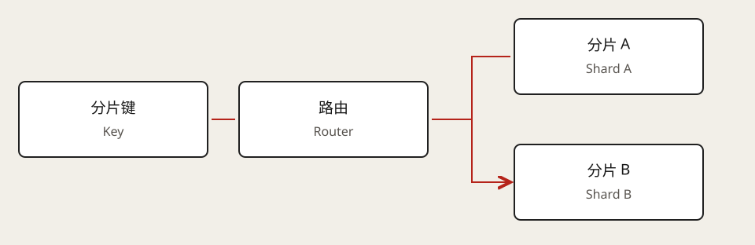

# 数据分片

> 范围：基于公开可访问的原文和主题目录整理；以下面试推演与自测为原创练习，不复刻 Premium 视频、测验或受限正文。

## 核心判断

分片（Sharding）把数据分散到多台机器；单实例分区（Partitioning）通常仍在同一个数据库实例内。复制（Replication）保存副本，不能直接替代写入分片。

先用测量判断瓶颈能否由索引、查询优化、纵向扩容或读副本解决。分片键（Shard Key）必须兼顾流量分布、数据局部性与热点；哈希、范围、目录路由各有维护成本。

## 面试推演：训练日志

以 `experiment_id` 分片可聚合实验查询，但超大实验会成为热分片（Hot Shard）。加入时间桶或子分片可以分散写入，同时增加读取扇出（Fan-out）。全局搜索可能需要单独的检索索引。

扩容要说明：存量迁移、增量复制或双写、路由切换、校验与回滚。跨分片事务（Cross-shard Transaction）和全局排序的成本也必须计入。

## 自测

- [ ] 单个用户占一半写流量时，哈希用户编号能解决吗？
- [ ] 跨分片取最近 20 条记录怎么合并？
- [ ] 路由版本不一致时，如何避免漏读和重复写？

## 相关笔记

[模块导航](../README.md) · [Core Concepts 总览](README.md)

来源：[Hello Interview · Sharding](https://www.hellointerview.com/learn/system-design/core-concepts/sharding)（核对日期：2026-10-25）。
