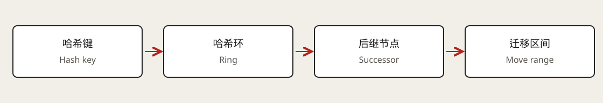

# 一致性哈希

一致性哈希（Consistent Hashing）解决的是节点集合变化时，如何减少键的重新分配。它是一种放置与路由方法，不负责让多个副本自动达成一致，也不替代持久化、复制或故障恢复。



## 取模路由为什么不利于直接扩容

固定数量节点时，`hash(key) % N` 简单而有效。但从 N 个节点改成 N+1 个节点，相当于改变大量键的路由规则。对缓存来说可能产生大面积未命中；对持久化存储来说，则需要搬迁和兼容旧位置。

问题不在于取模运算本身，而在于让物理节点数量直接参与键的归属计算。固定逻辑分区再映射到物理节点，是另一种可以降低这种耦合的方法。

## 哈希环怎样定位数据

把哈希空间首尾连接成环，将节点和键都映射到环上的位置。常见规则是从键的位置顺时针找到第一个节点，将其作为归属节点；超过最大位置则绕回开头。

假设环上位置为 `A=10, B=50, C=90`：键 30 归 B，键 70 归 C，键 95 绕回归 A。加入 `D=35` 后，原来归 B 的区间 `(10,35]` 转给 D，其他区间不因这次插入而改变。这个例子使用简化的整数位置，只用于说明归属规则。

```text
旧位置：10(A) ---- 30(key) -------- 50(B) -------- 90(C)
新位置：10(A) ---- 30(key) -- 35(D) -- 50(B) ----- 90(C)
```

理想均匀分布、节点等权时，增加一个节点平均大约接管 `1/(N+1)` 的键。这是关于分布和期望的近似，不代表每次扩容都恰好迁移这个比例，也不代表字节数和流量同样均衡。

## 虚拟节点改善什么

若每台机器只有一个位置，某台机器退出后可能让它的后继承担过多数据。虚拟节点（Virtual Node）让同一台物理机器拥有多个分散位置，把接管区间分散给更多机器。更强的机器可以配置更多位置，表达权重。

代价是更多路由元数据、区间管理和迁移任务。虚拟节点改善统计分布，不能把一个超热键拆成多份；键大小差异很大时，按键数平衡也不等于内存平衡。

## 路由还需要成员与版本协议

客户端、代理或服务端需要知道当前节点集合及环版本。节点加入、退出和故障检测会改变视图；如果不同请求使用不同版本，同一个键可能被发往不同位置。

迁移期间可以转发旧路由请求、提供重定向，或在受控阶段读取新旧位置。写入必须有明确的所有权和切换边界。单靠本地超时就把节点从环中移除，可能把网络分区误判成节点消失，从而造成多个写入方。

## 放置算法与复制恢复是两层问题

环决定“应该在哪里”，复制决定“还有哪些副本”。选择副本时，要区分不同物理机器、机架和可用区，不能把同一机器上的多个虚拟节点误当独立容灾副本。

缓存节点失败时可以从事实源重新构建；持久数据需要已存在的副本或恢复来源。扩容时的数据搬迁则要追踪存量与增量，并验证切换后的完整性。这些步骤不会因为使用了哈希环而自动完成。

## 热点与其他放置方案

热键可以使用进程缓存、读取复制、应用拆分或限流；每种方法都需要独立的一致性与失效策略。Rendezvous Hashing 等方法也能在成员变化时减少重映射，不能把“减少迁移”限定为只有环能实现。

Redis Cluster 是很好的反例：它用固定的 16,384 个哈希槽（Hash Slot）映射到节点，扩容时迁移槽，而不是直接使用这里画出的虚拟节点哈希环。[Redis Cluster 规范](https://redis.io/docs/latest/operate/oss_and_stack/reference/cluster-spec/)说明了槽位和重定向机制。讨论具体产品时，应区分算法思想与实际实现。

## 关联与来源

[分片](06-sharding.md) · [缓存](05-caching.md) · [CAP](08-cap-theorem.md)

学习入口：[Hello Interview · Consistent Hashing](https://www.hellointerview.com/learn/system-design/core-concepts/consistent-hashing)（已登录核对书面章节）。整数环例子和路由版本说明为独立讲解。
