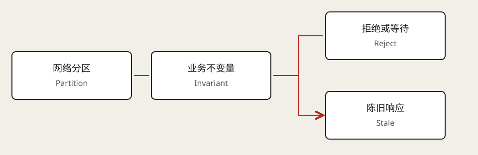

# CAP 与一致性取舍

> 范围：基于公开可访问的原文和主题目录整理；以下面试推演与自测为原创练习，不复刻 Premium 视频、测验或受限正文。

## 核心判断

CAP 讨论网络分区（Network Partition）发生时，一致性（Consistency）与可用性（Availability）的取舍。这里的一致性指线性一致性（Linearizability），不是 ACID 的一致性；可用性指非故障节点收到的请求最终得到响应，并非业务可用率指标。

不能把 CAP 理解为任何时候任意选两个。分区时，一侧可能拒绝或等待请求以维护一致性；继续服务则可能失去单一的全局实时视图。PACELC 还提醒我们，正常网络下也存在延迟与一致性的权衡。

## 面试推演：GPU 配额与进度展示

GPU 配额扣减需要明确的并发不变量，分区时可以选择拒绝分配，避免重复承诺。训练进度展示通常可以容忍短暂陈旧，允许稍后收敛。按操作选择语义，不能给整个产品只贴一个 CP/AP 标签。

最终一致性（Eventual Consistency）承诺在满足条件时收敛，但不自动承诺最大陈旧时间或冲突处理方式。

## 自测

- [ ] 用两个区域断连的例子，说明读和写分别如何处理。
- [ ] 为什么“用了 SQL”不能证明跨地域线性一致？
- [ ] 如何区分读己之写（Read-your-writes）与线性一致性？

## 相关笔记

[模块导航](../README.md) · [Core Concepts 总览](README.md)

来源：[Hello Interview · CAP & Consistency Trade-offs](https://www.hellointerview.com/learn/system-design/core-concepts/cap-theorem)（核对日期：2026-10-25）。
