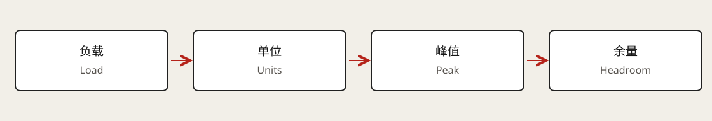

# 容量估算与数量级

容量估算（Capacity Estimation）用于支持一个架构决策：单机能否承担、缓存是否必要、存储保留多久、失去一个区域后是否仍有余量。数字应来自明确假设与测量，不能把某次厂商跑分背成通用上限。



## 先把问题转换成负载

日活用户（DAU）不等于同时在线用户，也不直接等于每秒请求数。先估计每个用户每天的操作次数，再区分每次操作触发多少服务调用、数据库读取、写入或消息。

```text
平均请求/秒 = 每日操作数 / 86,400
峰值请求/秒 = 平均请求/秒 × 明确假设的峰值系数
后端读取/秒 ≈ 请求/秒 × 每请求读取次数 × 未命中率
```

峰值系数不是行业常数，应考虑时区、定时任务、事件爆发和租户倾斜。扇出（Fan-out）、重试和后台任务会让内部流量高于外部请求量。

## 一个完整的训练日志估算

假设每天 1,000 万条日志，每条 2 KB，使用十进制单位，峰值为平均的 10 倍。这些数字是讲解假设，不是实测结果。

| 项目 | 算式 | 结果 |
| --- | --- | --- |
| 平均写入 | `10,000,000 / 86,400` | 约 116 条/秒。 |
| 峰值写入 | `116 × 10` | 约 1,160 条/秒。 |
| 每日原始数据 | `10,000,000 × 2,000 B` | 20 GB/天。 |
| 30 天原始保留 | `20 × 30` | 600 GB。 |
| 三副本原始数据 | `600 × 3` | 1.8 TB。 |
| 峰值有效载荷带宽 | `1,160 × 2,000 B/s × 8` | 约 18.6 Mb/s。 |

这还没有包括索引、对象元数据、协议头、复制流量、备份和压缩。三副本也不等于拥有三份独立历史备份：误删可能同步复制到所有副本。

## 延迟、吞吐与并发的关系

延迟（Latency）是一个请求所花的时间；吞吐（Throughput）是一段时间内完成的工作量；并发（Concurrency）是在系统中同时存在的工作数量。三者不能直接互换。

稳定系统里的利特尔定律（Little's Law）使用平均值：`平均在途数 = 平均到达率 × 平均停留时间`。例如 2,000 请求/秒、平均停留 0.1 秒，对应约 200 个在途请求。不能用 p99 替换平均值，也不能把长期不稳定、队列持续增长的状态当作稳态。

端到端 p99 也不能简单相加成各组件 p99 之和；多个依赖的扇出、相关故障和排队会改变尾部。应给各阶段分配延迟预算，再通过端到端观测核实。

## 资源维度要分别计算

CPU 要看每次请求的计算成本和并行效率；内存要看常驻数据、连接缓冲与对象开销；磁盘要看容量、IOPS、带宽和日志持久化；网络要看请求体、响应体、复制和跨区流量。

假设每个活跃连接平均占 32 KiB 内存，10 万连接仅该部分就约 3.05 GiB。这个结果来自假设，不代表某种服务器的固定连接开销；TLS、应用对象和内核状态可能另计。带宽上限也不等于小请求吞吐上限，后者可能受 CPU 或包处理限制。

## 为什么不能记死数据库或缓存的 QPS

相同硬件上，单键读取、复杂 JOIN、大事务、同步持久化和大对象返回的成本不同。索引数量、数据是否在内存、连接数、批量大小和锁竞争都会改变上限。

一次有效测量需要说明数据规模、请求分布、读写比、对象大小、持久性、缓存状态、延迟目标与错误率。容量应取满足目标延迟和错误率时的可持续吞吐，而不是短时间内把系统压到崩溃前的最高值。

## 预留故障与恢复的余量

正常情况下刚好够用的集群，可能无法承担单节点或单可用区故障。容量规划应按允许的故障情景计算剩余能力，还要预留重新复制、缓存预热、积压清理和部署期间的资源。

队列也只是把时间和容量问题推迟。若进入队列为 1,500 条/秒、处理为 1,200 条/秒，积压每秒增长 300 条。恢复后必须让处理速率超过新增速率，才有机会清空；清空时间近似为 `积压量 / (处理率 - 新增率)`，同样需要稳定负载假设。

## 用估算推动选择

先找最紧的资源，再比较小范围改动：减少查询、优化索引、批处理或增加单机资源。只有测量和增长预测显示这些不足时，才讨论缓存、异步化或分片。

如果不确定某个参数，可以计算两个情景，例如记录大小翻倍、峰值系数从 10 变 20。观察哪个假设改变了设计结论，比报出许多没有用途的数字更有说服力。云价格变化较快，真实成本比较需要按实际区域和配置重新查价。

## 关联与来源

[索引](04-database-indexing.md) · [缓存](05-caching.md) · [分片](06-sharding.md) · [强化学习系统](../../04-rl-systems/knowledge-map.md)

学习入口：[Hello Interview · Numbers to Know](https://www.hellointerview.com/learn/system-design/core-concepts/numbers-to-know)（已登录核对书面章节）。本页的负载、连接和积压数字都是明确假设下的独立算例，不当作厂商性能承诺。
